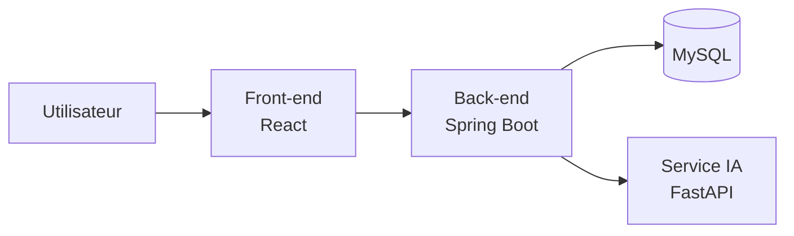

# Gestion hôtelière intelligente

Application web de gestion hôtelière avec **prédiction des annulations** et **aide à la décision pour l'overbooking**.

> Projet de fin d'année (PFA) et projet DevOps · EMSI · 5DSIO · Année universitaire 2026/2027

## Sommaire

- [Équipe](#équipe)
- [Problématique](#problématique)
- [Fonctionnalités](#fonctionnalités)
- [Architecture](#architecture)
- [Stack technique](#stack-technique)
- [Partie intelligence artificielle](#partie-intelligence-artificielle)
- [Sécurité et tests](#sécurité-et-tests)
- [Installation et lancement](#installation-et-lancement)
- [Avancement](#avancement)
- [Documentation](#documentation)

## Équipe

| Membre | Établissement |
|---|---|
| Manal Lahmer | EMSI |
| Aymen Nafis | EMSI |

Encadrante PFA : Mme Ounacer Soumia

## Problématique

Les annulations de dernière minute laissent des chambres vides, tandis qu'un overbooking mal dimensionné oblige à reloger des clients.

**Comment aider un hôtel à anticiper les annulations et à décider du nombre de réservations à accepter au-delà de sa capacité ?**

## Fonctionnalités

**Socle de gestion** : clients, réservations, disponibilité des chambres, check-in / check-out, extras et facturation.

**Aide à la décision** (six axes) :

| Axe | Rôle |
|---|---|
| Analyse prédictive | Probabilité d'annulation de chaque réservation |
| Aide à l'overbooking | Nombre de réservations supplémentaires à accepter selon un seuil de risque réglable |
| Simulation | Scénarios « et si » par simulation Monte Carlo |
| Analyse des risques | Classes de risque et alertes |
| Aide à la prise de décision | Recommandations expliquées |
| Business Intelligence | Tableaux de bord construits en React |

**Rôles utilisateurs** : réceptionniste, responsable / revenue manager, administrateur.

## Architecture

Principes de conception :

- le front ne communique qu'avec l'API Spring Boot, seul point d'entrée ;
- seule l'API Spring Boot accède à la base MySQL ;
- le service IA est sans état : il reçoit les données dans la requête et renvoie un résultat ;
- si le service IA est indisponible, la réservation reste possible et le score est marqué « non calculé ».

## Stack technique

| Composant | Technologie |
|---|---|
| Front-end | React, Recharts |
| Back-end | Spring Boot, JPA, JWT |
| Service IA | FastAPI, scikit-learn, XGBoost / LightGBM, SHAP |
| Base de données | MySQL, migrations Flyway |
| Documentation API | Swagger / OpenAPI |
| Livraison | Docker Compose |

## Partie intelligence artificielle

- **Problème** : classification binaire (réservation annulée ou non), avec une probabilité calibrée en sortie.
- **Données** : [Hotel Booking Demand](https://www.sciencedirect.com/science/article/pii/S2352340918315191), 119 390 réservations de deux hôtels portugais (2015-2017), 87 396 lignes après suppression des doublons.
- **Variables** : 23 variables explicatives retenues sur 32 colonnes, en excluant les fuites de données (`reservation_status`, `reservation_status_date`).
- **Évaluation** : découpage temporel (entraînement 2015-2016, test 2017) ; objectif AUC-ROC ≥ 0,85, supérieure à la baseline en régression logistique.
- **Overbooking** : simulation Monte Carlo à partir des probabilités d'annulation, avec capacité et coûts réglables par le directeur.

## Sécurité et tests

- Authentification JWT, mots de passe hachés (BCrypt), contrôle d'accès par rôle côté serveur.
- Validation des entrées, requêtes paramétrées, CORS restreint, service IA non exposé.
- Tests : unitaires, concurrence, intégration, modèle IA, décision et interface.

## Installation et lancement

À venir : les quatre composants seront conteneurisés et lancés avec Docker Compose.

## Avancement

- [x] Cahier des charges validé
- [x] Document de conception validé
- [ ] Développement en cours
- [ ] Volet DevOps (à venir)

## Documentation

Le cahier des charges et le document de conception seront ajoutés dans ce dépôt.
